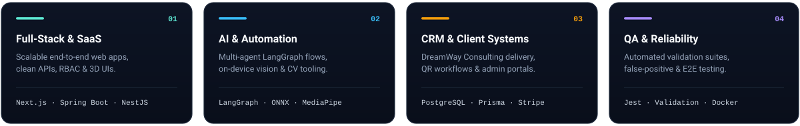

  

  
  &nbsp;
  
  &nbsp;
  
  &nbsp;
  

---

### 👋 About Me

I'm **Walid El Bassouri** — **Founder of [DreamWay Consulting](https://dreamwayinc.tech) and Co-founder of [DreamWay](https://dreamway.ma)**, and a **Software Engineer & QA Tester** focused on building reliable, scalable products across **Full-Stack Development**, **AI & Automation**, **CRM Systems**, and **Scalable SaaS Solutions**.

From leading end-to-end digital ventures and building production client platforms to engineering on-device Edge AI systems, enterprise Java/NestJS backends, interactive 3D web experiences, and automated validation suites, I bridge **product leadership**, **software architecture**, and **quality assurance** so every system ships cleanly and scales with confidence.

  

---

### 🏆 The DreamWay Ecosystem

<table>
  <tr>
    <td width="50%" valign="top">
      <h3>🌐 <a href="https://dreamwayinc.tech">DreamWay Consulting</a> — <code>dreamwayInc.tech</code></h3>
      

        <strong>Founder</strong> · <em>"We build the way to your growth."</em>
      

      

        Full-service digital &amp; technology partner taking ambitious businesses from A to Z across custom web platforms, scalable IT systems, branding, digital media, and growth execution.
      

      
🔗 <a href="https://dreamwayinc.tech"><strong>Visit dreamwayInc.tech</strong></a>

    </td>
    <td width="50%" valign="top">
      <h3>🎓 <a href="https://dreamway.ma">DreamWay Education</a> — <code>dreamway.ma</code></h3>
      

        <strong>Co-founder</strong> · <em>Academic Orientation &amp; European Admissions Platform</em>
      

      

        Official student orientation &amp; placement platform guiding Moroccan students toward accredited state universities across Hungary &amp; Europe—featuring program discovery, candidate tracking, and consular guidance (<strong>350+ admitted students</strong> · <strong>98% D-visa success</strong> · <strong>15+ partner state universities</strong>).
      

      
🔗 <a href="https://dreamway.ma"><strong>Visit dreamway.ma</strong></a>

    </td>
  </tr>
</table>

---

### 🚀 Featured Systems & Flagship Projects

<table>
  <tr>
    <td width="50%" valign="top">
      <h3>🛡️ <a href="https://github.com/Poot-bs/Rakez-ai">Rakez AI</a> — Edge AI &amp; Multi-Agent Flow Cockpit</h3>
      

        Autonomous on-device vision intelligence &amp; cognitive coaching desktop command center + Chrome MV3 extension built to protect deep developer flow with <strong>zero cloud frame telemetry</strong>.
      

      <ul>
        <li><strong>Edge Vision:</strong> Real-time MediaPipe FaceMesh (468 landmarks) + ONNX Runtime Web distraction &amp; fatigue scoring.</li>
        <li><strong>Multi-Agent AI:</strong> LangGraph + Groq orchestration decomposing task-switching friction into actionable micro-steps.</li>
        <li><strong>QA &amp; Validation:</strong> Automated MVP contract &amp; false-positive calibration suites (<code>validate:mvp</code>, <code>validate:false-positives</code>).</li>
      </ul>
      
<code>Electron</code> · <code>React</code> · <code>MediaPipe</code> · <code>ONNX</code> · <code>LangGraph</code> · <code>WebSockets</code> · <code>Chrome MV3</code>

    </td>
    <td width="50%" valign="top">
      <h3>🌱 <a href="https://github.com/Poot-bs/AGREON">AGREON</a> — AI Smart Agriculture Command Center</h3>
      

        Next-generation AgriTech SaaS platform unifying crop intelligence, spatial farm mapping, smart irrigation controls, IoT device monitoring, and executive analytics.
      

      <ul>
        <li><strong>Spatial Intelligence:</strong> Interactive polygon farm maps &amp; zone telemetry powered by Leaflet and Recharts.</li>
        <li><strong>AI Advisory UX:</strong> Confidence-scored crop health workflows with real-time Socket.io feeds and Zustand state.</li>
        <li><strong>Multilingual Ready:</strong> Built-in i18n architecture supporting English, French, and Arabic field operations.</li>
      </ul>
      
<code>React 19</code> · <code>TypeScript</code> · <code>Tailwind CSS 4</code> · <code>Leaflet</code> · <code>Recharts</code> · <code>Zustand</code> · <code>Socket.io</code>

    </td>
  </tr>
  <tr>
    <td width="50%" valign="top">
      <h3>💳 <a href="https://github.com/Poot-bs/BITIKA-FULLSTACK">BITIKA Full-Stack</a> &amp; <a href="https://github.com/Poot-bs/BTK_Cards">BTK Cards</a></h3>
      

        Scalable SaaS &amp; CRM platform combining client project intake, Stripe billing, JWT/NextAuth RBAC, and an end-to-end digital business card &amp; QR analytics system.
         
        🔗 <a href="https://btk-cards.vercel.app"><strong>Live Demo (BTK Cards)</strong></a>
      

      <ul>
        <li><strong>Backend Architecture:</strong> Modular NestJS 11 + TypeORM + PostgreSQL alongside Express/MongoDB services.</li>
        <li><strong>Client &amp; CRM Flows:</strong> Custom admin dashboards, short URL routing, QR generation, and Supabase media hosting.</li>
      </ul>
      
<code>Next.js 15</code> · <code>NestJS 11</code> · <code>TypeORM</code> · <code>Prisma</code> · <code>PostgreSQL</code> · <code>MongoDB</code> · <code>Stripe</code> · <code>Docker</code>

    </td>
    <td width="50%" valign="top">
      <h3>🚗 <a href="https://github.com/Poot-bs/tawsila">Tawsila / UniRide</a> — Full-Stack Carpooling SaaS</h3>
      

        Enterprise OOP university carpooling platform supporting passenger, driver, and admin lifecycles with seat reservations, notifications, and live cloud deployment.
         
        🔗 <a href="https://tawsila-eta.vercel.app"><strong>Live Demo (Tawsila)</strong></a>
      

      <ul>
        <li><strong>Layered Backend:</strong> Java 17 + Spring Boot 3 with strategy-pattern persistence (In-Memory / PostgreSQL &amp; Supabase).</li>
        <li><strong>Trilingual Frontend:</strong> Next.js 15 + React 19 with full FR / EN / AR localization and containerized Render/Vercel delivery.</li>
      </ul>
      
<code>Java 17</code> · <code>Spring Boot 3</code> · <code>Next.js 15</code> · <code>PostgreSQL</code> · <code>Supabase</code> · <code>Docker</code> · <code>next-intl</code>

    </td>
  </tr>
  <tr>
    <td width="50%" valign="top">
      <h3>🏗️ <a href="https://github.com/Poot-bs/mega-post-tension">MEGA SA Post-Tension</a> — 3D WebGL Engineering</h3>
      

        Cinematic industrial engineering platform built with scroll-choreographed 3D scenes, smooth Lenis motion, and adaptive dark/light trilingual architecture (FR / EN / AR RTL).
         
        🔗 <a href="https://mega-post-tension.vercel.app"><strong>Live Site (MEGA SA)</strong></a>
      

      
<code>Next.js</code> · <code>Three.js</code> · <code>React Three Fiber</code> · <code>GSAP</code> · <code>Framer Motion</code> · <code>Lenis</code> · <code>Tailwind CSS</code>

    </td>
    <td width="50%" valign="top">
      <h3>☕ <a href="https://github.com/Poot-bs/LONDON-EXPRESS">London Express</a> &amp; 💡 <a href="https://github.com/Poot-bs/LUMA">LUMA</a></h3>
      

        <strong>London Express Coffee:</strong> Table-aware QR digital menu, instant WhatsApp ticket checkout, printable table stands, and a PIN-protected manager price/stock dashboard (<code>Python</code> · <code>JS</code>).
          
        <strong>LUMA:</strong> Privacy-by-design monorepo platform engineered for anonymous reporting and moderation-first community workflows (<code>Next.js</code> · <code>Express</code> · <code>MongoDB</code> · <code>TypeScript</code>).
      

    </td>
  </tr>
</table>

  
<strong>📂 Explore Additional Applied &amp; Research Systems</strong>

   

| Project | Domain & Engineering Highlights | Core Stack |
| :--- | :--- | :--- |
| [**Hyperbola Detection & Interpolation**](https://github.com/Poot-bs/Matlab-Project_detectation_Auto_Heperboles) | Dual MATLAB + Python computer vision pipeline using Canny edge detection, SVD conic fitting, Linear/Polynomial/Cubic Spline interpolation, and EMR accuracy evaluation. | `MATLAB` · `Python` · `OpenCV` · `SciPy` · `NumPy` |
| [**Urbanet**](https://github.com/Poot-bs/urbanet) | Modern responsive real-estate web storefront and interactive service showcase. | `React 19` · `Vite` · `JavaScript` |
| [**EduLib (EDULAB)**](https://github.com/Poot-bs/EDULAB) | Academic library portal managing student records, catalog inventory, and book loans. | `PHP` · `MySQL` · `HTML/CSS` |
| [**Itaco Cards**](https://github.com/Poot-bs/itaco-cards) | QR digital loyalty card generator with session-authenticated admin dashboard. | `Python` · `Flask` · `SQLite` |

---

### 🧪 Engineering & QA Philosophy

| Pillar | How I Build & Verify |
| :--- | :--- |
| **QA & Validation Rigor** | Automated MVP contract checks, false-positive tolerance suites, Jest tests, and reproducible edge-case testing before production release. |
| **Scalable Architecture** | Strict separation of concerns (`Controller → Service → Repository`), monorepo workspaces, typed DTOs, and strategy-driven persistence. |
| **Security & Privacy** | On-device AI processing with zero cloud telemetry, JWT / NextAuth RBAC, bcrypt password hashing, and rate-limited API guards. |
| **Product Delivery** | Dockerized services, Prisma / TypeORM schema migrations, CI-friendly health probes, and polished multilingual (`EN / FR / AR` + RTL) interfaces. |

---

### 🛠️ Technical Stack

**Frontend & Interactive 3D**

  
  
  
  
  
  
  
  
  
  

**Backend, APIs & Databases**

  
  
  
  
  
  
  
  
  
  
  
  
  
  

**AI, Automation & Edge Vision**

  
  
  
  
  
  

**QA Testing, DevOps & Foundations**

  
  
  
  
  
  
  
  

---

### 📊 Language Footprint & Contribution Activity

  

  

 

 

---

  <strong>Founder @ <a href="https://dreamwayinc.tech">DreamWay Consulting</a> · Co-founder @ <a href="https://dreamway.ma">DreamWay</a> · Connect on <a href="https://www.linkedin.com/in/walid-el-bassouri-654257273/">LinkedIn</a> · <a href="mailto:walidwalis131@gmail.com">walidwalis131@gmail.com</a></strong>

